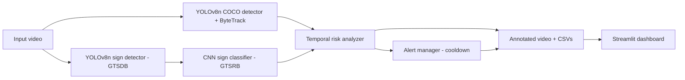
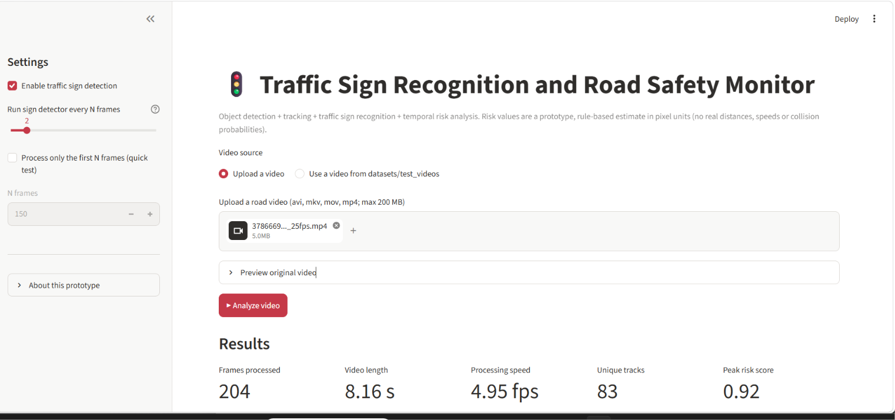
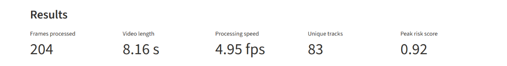
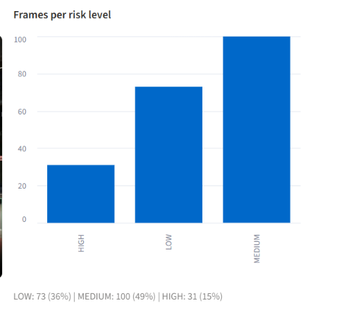
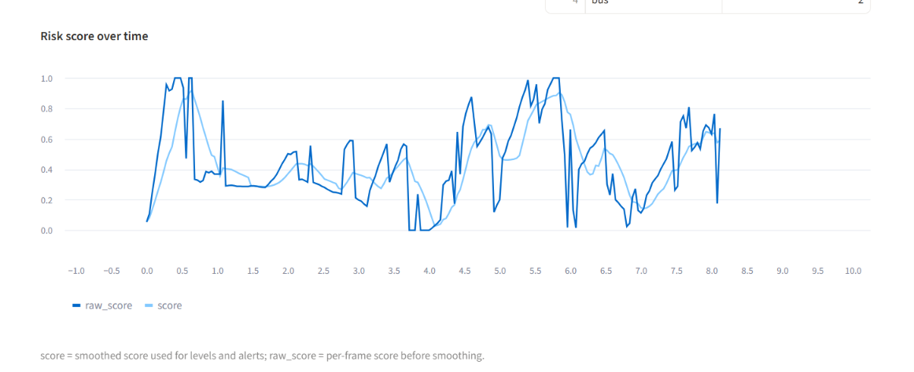

# Traffic Sign Recognition and Road Safety Monitor

Combining traffic sign classification, object detection, multi-object tracking and temporal risk analysis in one video pipeline with a Streamlit dashboard.

**Author:** <Shivi Prajapati>, B.Tech Computer Science (AI/ML)

> **Honest scope:** the risk module is a rule-based prototype working in pixel units on a single uncalibrated camera. It does not measure real distances or speeds and does not predict collisions. See [Limitations](#limitations).

## What it does

| Module | Method | Data |
|---|---|---|
| Sign classification | Small VGG-style CNN (43 classes) | GTSRB |
| Sign detection | YOLOv8n fine-tuned, one class (`traffic_sign`), 960 px | GTSDB |
| Road objects | Pretrained YOLOv8n (COCO): pedestrian, bicycle, car, motorcycle, bus, truck | COCO (pretrained) |
| Tracking | ByteTrack (via Ultralytics), per-object trajectories | - |
| Risk analysis | Rule-based temporal scoring with persistence, smoothing and alert cooldown | - |
| Dashboard | Streamlit: upload, progress, annotated video, alerts, risk charts, downloads | - |

## Architecture



Per frame: detect and track road objects, detect signs (every 2nd frame by default), classify each cropped sign, score risk from the tracks, then turn the smoothed risk level into a small number of alerts.

## Results

All numbers below come from the evaluation scripts in this repo.

### Sign classifier (GTSRB, official test set: 12,630 images)

| Metric | Value |
|---|---|
| Accuracy | 99.00% (12,504 correct) |
| Macro precision / recall / F1 | 0.9867 / 0.9843 / 0.9850 |
| Weighted precision / recall / F1 | 0.9904 / 0.9900 / 0.9899 |
| Best validation accuracy | 99.20% (checkpoint at epoch 13) |

Weakest classes: Bumpy road (recall 0.783), Double curve (0.844). Most frequent confusions: Bumpy road -> Road work, Speed limit 60 -> 80. Run `python evaluate.py` to reproduce; the confusion matrix is in `outputs/evaluation/`.

### Sign detector (GTSDB, YOLOv8n, 960 px, single class)

The 765 usable images were split sequentially by file index: train 00000-00629 (630), validation 00630-00764 (135), test 00765-00899 (135). The checkpoint was chosen on validation only; the test split was scored once.

| Split | Images / boxes | Precision | Recall | mAP50 | mAP50-95 |
|---|---|---|---|---|---|
| Validation (used to pick the checkpoint) | 135 / 160 | 0.986 | 0.981 | 0.994 | 0.878 |
| **Test (held out)** | 135 / 164 | **0.981** | **0.965** | **0.976** | **0.876** |

The sets are small (about 160 boxes each), so differences of a point or two are not meaningful. Run `python evaluate_sign_detector.py` to reproduce. Inference was 11.5 ms per image at 960 px on an RTX 2050 during validation.

### Video pipeline (qualitative, no ground truth)

Three stock-footage videos were processed. The table shows the share of frames at each risk level with the current settings. **These are alert rates, not accuracy**: there are no labelled risk events to score against.

| Video | Objects per frame (mean) | LOW | MEDIUM | HIGH |
|---|---|---|---|---|
| Sparse scene | 4.2 | 60% | 32% | 8% |
| Crowded street, 1080p | 11.0 | 36% | 49% | 15% |
| Very crowded street | 15.8 | 17% | 46% | 38% |

One measured speed: 7.7 frames/s on a 1920x1080 clip with sign detection on, on an RTX 2050 (4 GB). The risk engine still flags a large share of frames in very crowded scenes (see Limitations).

### Unit tests of the risk and alert logic

`python src\risk_analyzer.py` (10 synthetic scenarios: far apart, approaching pedestrian, one-frame glitch, density only, vehicle queue, motorcycle rider, warning sign, crowded static street, parallel walking) and `python src\alert_manager.py` (8 scenarios: cooldown, escalation, reminders, flapping). Both pass.

## How the risk score works

Each frame produces a score from 0 to 1, in pixel space:

- **Pedestrian/bicycle near a vehicle:** distance between the objects' foot points divided by their mean box diagonal. Counts fully only when the gap has been shrinking over the last 6 frames; otherwise at 35%.
- **Vehicle near vehicle:** same idea, weight 0.5, counts at 25% when not closing.
- **Warning sign context:** a Pedestrians / Children crossing / Bicycles crossing sign with a vulnerable road user nearby adds a small amount.
- **Density:** many tracked objects amplify existing risk by up to 25%; a busy scene with nothing close scores zero.
- **Persistence:** a factor ramps up over 8 frames, so a one-frame glitch cannot raise the level.
- **Smoothing:** moving average over 10 frames. LOW below 0.35, MEDIUM from 0.35, HIGH from 0.65.
- **Alerts:** one per risk episode, one more on escalation to HIGH, a reminder every 10 s while HIGH continues, and a 3 s cooldown of LOW before a new episode can alert.

The weights and thresholds are heuristic. They were adjusted by looking at three clips, not tuned on labelled data.

## Setup (Windows, Python 3.13)

```powershell
git clone <https://github.com/ShiviPrajapati-git/traffic-sign-road-safety>
cd <repo folder>
python -m venv venv
.\venv\Scripts\Activate.ps1
```

Install PyTorch first, using the command for your system from https://pytorch.org (CPU or CUDA), then:

```powershell
pip install -r requirements.txt
python check_setup.py
```

Tested with Python 3.13.1, torch 2.15.0 (CUDA), Ultralytics 8.4.215.

## Data

Datasets are not included. Download them and place them as follows (verify):

- **GTSRB** in `datasets\GTSRB\` with `Train\`, `Test\` and `Test.csv`.
- **GTSDB** in `datasets\GTSDB\`, then convert to YOLO format (this also creates the train/val/test split and `dataset.yaml`):
  ```powershell
  python src\prepare_gtsdb.py
  python src\verify_gtsdb_yolo.py
  ```
- Test videos go in `datasets\test_videos\` (any short road video in mp4/avi/mov/mkv).

The pretrained `yolov8n.pt` COCO weights download automatically on first use.

## Training and evaluation

```powershell
# 1. Sign classifier (writes models\traffic_sign_cnn.pth, training curves)
python src\train_classifier.py
python evaluate.py

# 2. Sign detector
yolo detect train model=yolov8n.pt data="$PWD\datasets\GTSDB_YOLO\dataset.yaml" imgsz=960 epochs=50 batch=8 workers=0 patience=15 project="$PWD\models\sign_detector" name=gtsdb_yolov8n_960
Copy-Item "models\sign_detector\gtsdb_yolov8n_960\weights\best.pt" "models\traffic_sign_yolo.pt"
python evaluate_sign_detector.py
```

The trained final models (`models\traffic_sign_cnn.pth`, `models\traffic_sign_yolo.pt`, `models\sign_norm_stats.json`) are included, so you can skip training and run the pipeline directly.

## Run

Dashboard:

```powershell
python -m streamlit run app.py
```

Command line, one video:

```powershell
python src\video_processor.py --source "datasets\test_videos\<video>.mp4"
```

Outputs: annotated video in `outputs\annotated_videos\`, alerts and per-frame risk CSVs in `outputs\predictions\`.

## Screenshots

<!-- Add after capturing: docs/screenshots/1_home.png, 2_results.png, 3_alert_frame.png, 4_timeline.png -->






## Project structure

```
app.py                       Streamlit dashboard
config.py                    paths, thresholds, constants
check_setup.py               environment check
evaluate.py                  classifier test-set metrics
evaluate_sign_detector.py    detector test-split metrics
src/
  preprocessing.py           GTSRB loading and normalization
  traffic_sign_classifier.py CNN, checkpoint helpers, inference wrapper
  train_classifier.py        classifier training
  prepare_gtsdb.py           GTSDB -> YOLO conversion and split
  verify_gtsdb_yolo.py       checks the converted dataset
  sign_detector.py           detect signs, classify each crop
  object_detector.py         COCO road-object detector
  tracker.py                 ByteTrack tracking and trajectories
  risk_analyzer.py           temporal rule-based risk (with unit tests)
  alert_manager.py           alert cooldown logic (with unit tests)
  video_processor.py         full pipeline, annotated video, CSVs
models/                      final model weights
outputs/evaluation/          metrics, confusion matrix, plots
```

## Limitations

- **Risk is a heuristic, not a measurement.** No camera calibration, so no real distances, speeds or collision probabilities. There is no labelled risk data, so alert accuracy cannot be computed.
- **Crowded scenes are over-flagged.** In a very crowded video 84% of frames were MEDIUM or HIGH. Pedestrian-vehicle proximity in the image is not the same as proximity on the road (no depth).
- **ID switches in crowds.** ByteTrack has no appearance model, so IDs can change when people overlap. The number of track IDs created is therefore not the number of people. Tracking was checked visually only.
- **A moving camera shifts all positions,** which can affect the "closing" check.
- **German signs only.** GTSRB and GTSDB contain German signs; other countries' signs can be misclassified. Sign detections in videos without real signs may be false positives.
- **Small test sets:** the detector test split has 164 boxes, so its metrics are coarse.

## Licences and acknowledgements

- GTSRB: Stallkamp et al., "Man vs. computer: Benchmarking machine learning algorithms for traffic sign recognition", Neural Networks 32 (2012).
- GTSDB: Houben et al., "Detection of traffic signs in real-world images: The German Traffic Sign Detection Benchmark", IJCNN 2013.
- Detection and tracking use [Ultralytics](https://github.com/ultralytics/ultralytics) YOLOv8 (AGPL-3.0; check the current terms). Check each dataset's terms of use before redistributing anything derived from them.
- Test videos are stock footage and are not included in this repository.
